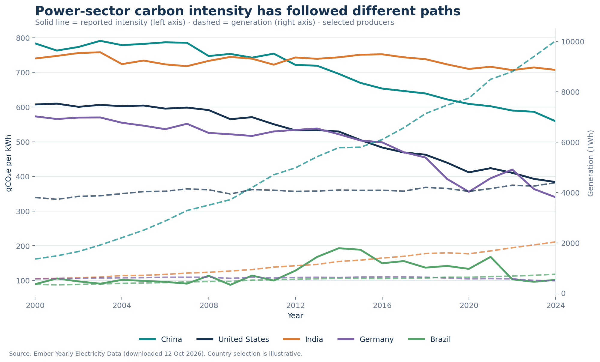
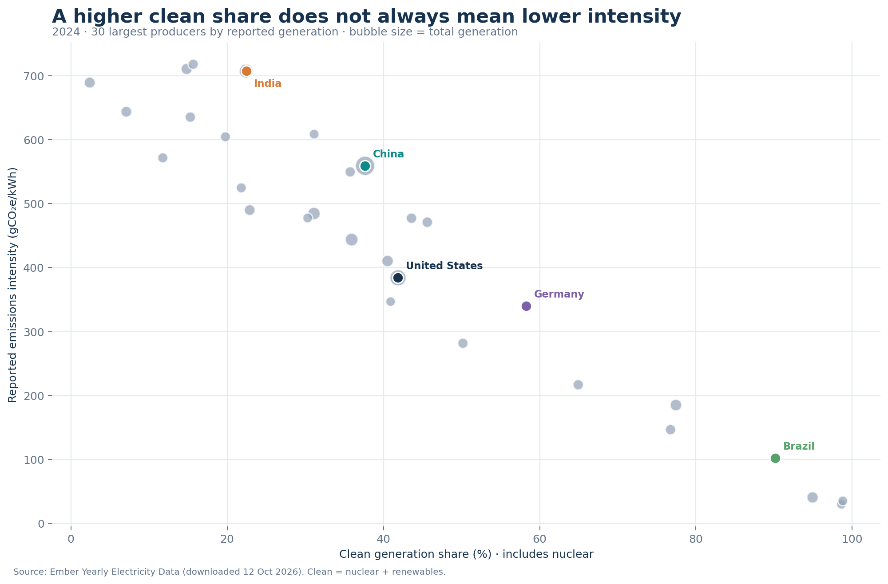
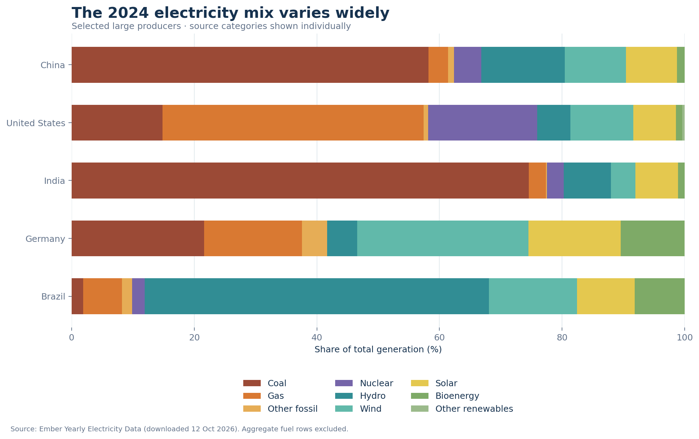

# Electricity Transition Monitor

## Objective

Compare electricity generation mix and power-sector carbon intensity across the 30 largest electricity producers in Ember's 2024 data. The analysis covers 2000–2024 and is designed to answer:

- Which large producers increased clean generation while lowering carbon intensity?
- How do generation mix and intensity differ across countries?
- Where does fossil generation remain a large part of the mix?

## Data

Source: Ember, [Yearly Electricity Data — Global](https://ember-energy.org/data/yearly-electricity-data/), downloaded 12 October 2026. Ember releases this dataset under CC BY 4.0; retain attribution when reusing the data.

The raw source is in `data/ember_global_yearly.csv`. The prepared analysis includes the 30 countries or economies with the highest reported total generation in 2024, for 2000–2024. 2025 is omitted because the latest year may contain estimates and is not directly comparable with completed years.

## Files

- `data/fact_country_year.csv` — one record per selected country/economy and year, with total generation and power-sector emissions metrics.
- `data/fact_generation_source.csv` — generation by fuel source; aggregate categories, demand, and net imports are excluded to avoid double counting.
- `data/powerbi_web_input.tsv` — flattened country-year table for the Power BI Service browser workflow.
- `Electricity-Transition-Monitor.pbix` — interactive report with a yearly average-intensity trend, generation-mix chart, country selector, and total-generation card.
- `measures_web.dax` — DAX measure definitions for extending the single-table report.
- `data/ember_global_yearly.csv` — source snapshot.
- `prepare_data.py` — recreates the two prepared tables from the source CSV using Python's standard library.
- `measures.dax` — report measures.
- `make_charts.py` and `visuals/` — reproducible analysis charts for the project and portfolio posts.

## Data model

The prepared CSVs support a star schema with two fact tables: `FactCountryYear` and `FactGenerationSource`. Add shared `DimCountry` and `DimDate` dimensions. Connect each dimension one-to-many to both facts; keep the facts disconnected. Use ISO 3 code as the country key where available, and Area for any records without a code. Relate the date dimension by year. The included PBIX uses the flattened `powerbi_web_input` table to keep its import workflow simple.

## Measures and definitions

- **Clean generation:** nuclear plus renewables (solar, wind, hydro, bioenergy, and other renewables), following the source's clean-generation grouping.
- **Fossil generation:** coal, gas, and other fossil sources.
- **Clean/fossil share:** the corresponding generation divided by total generation.
- **Carbon intensity:** Ember's reported power-sector emissions intensity, in gCO2e/kWh.

The DAX measures for the two-fact model are in `measures.dax`. For the single-table browser workflow, use `measures_web.dax` and `data/powerbi_web_input.tsv`. The included report has an Area slicer, a yearly generation-mix chart, an average reported-intensity trend, and a generation card. The unfiltered card sums all included country-year rows; select a country in the slicer to scope the visuals. PNG analysis charts are in `visuals/`; they are generated from the prepared data and are not screenshots of a Power BI report.

## Charts







## Snapshot observations

Values below are from this included snapshot and are rounded:

- China generated 10,025 TWh in 2024. Clean generation was 37.7% of its mix; reported intensity declined from 784 gCO2e/kWh in 2000 to 559 in 2024.
- The United States generated 4,391 TWh in 2024. Clean generation was 41.9%; reported intensity declined from 608 in 2000 to 384 in 2024.
- Germany's clean share was 58.3% in 2024, and reported intensity declined from 573 in 2000 to 340 in 2024.
- Brazil's clean share was 90.1% in 2024, while reported intensity was higher than in 2000 (102 versus 89).
- India's 2024 mix was 77.6% fossil generation.

These comparisons are descriptive. They do not establish why a country's emissions or generation mix changed.

## Recreate the prepared tables

From this project directory, run:

```bash
python3 prepare_data.py
```

The script selects the top 30 producers using 2024 total generation, then writes the two prepared CSV tables into `data/`. To recreate the PNGs, install Matplotlib and run `python3 make_charts.py`.

## Limitations

- The top-30 selection depends on 2024 reporting coverage and is not representative of all countries.
- Ember may revise historical values; results are tied to the included snapshot.
- Country reporting conventions vary. Emissions intensity is a reported power-sector metric, not a lifecycle emissions measure.
- Generation mix and carbon intensity are descriptive measures; they do not establish causation.
